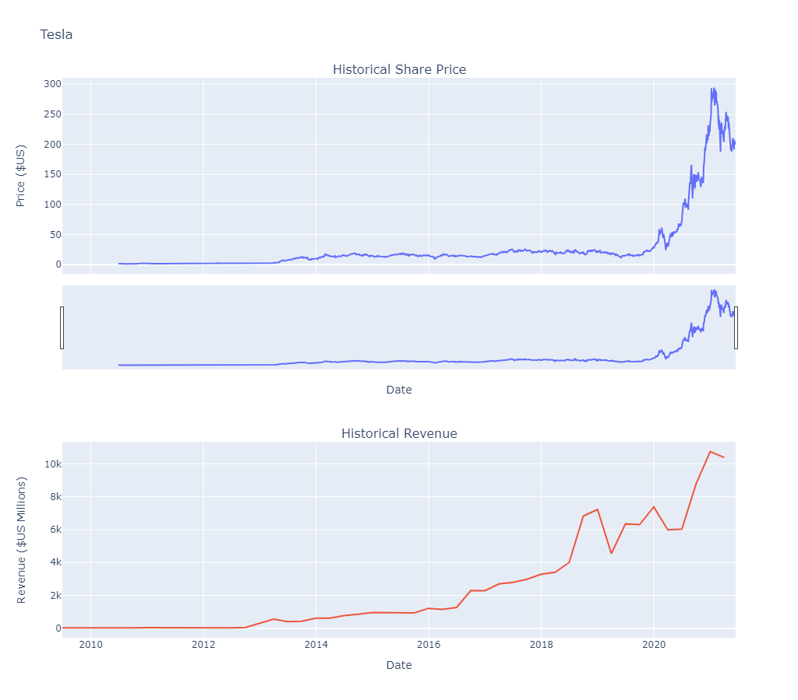
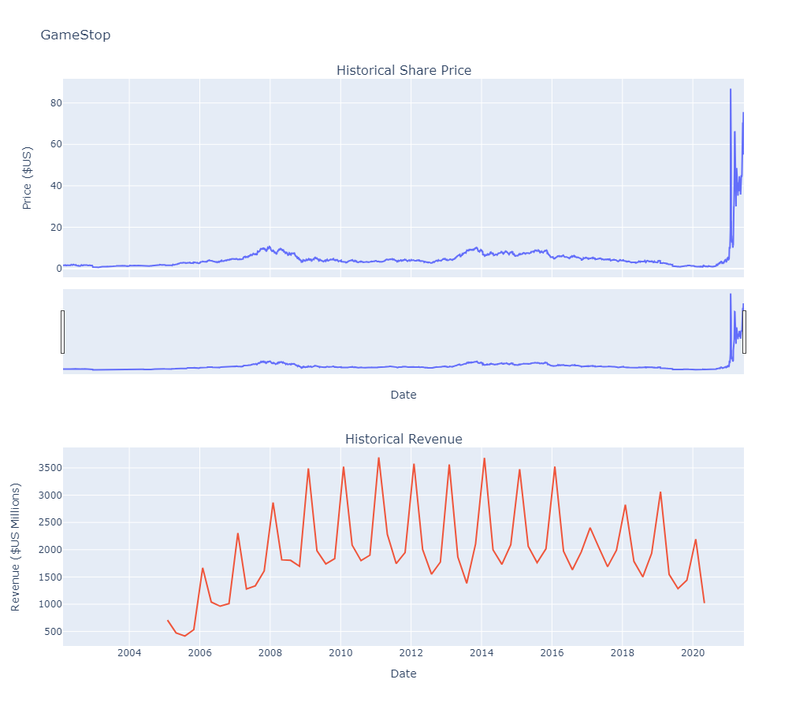

# IBM Data Science Professional Certificate

Projects I completed for the [IBM Data Science Professional Certificate](https://www.coursera.org/professional-certificates/ibm-data-science) on Coursera.

<!-- Add your certificate link here, for example:
[View my certificate](https://www.coursera.org/account/accomplishments/professional-cert/YOUR-ID) -->

**Skills:** Python · pandas · APIs (yfinance) · web scraping (requests, BeautifulSoup) · data cleaning · data visualization (Plotly) · Jupyter · Git

## Projects

### Tesla and GameStop: share price vs. revenue

[Open the notebook](05-Python-Project-for-Data-Science/tesla-gamestop-stock-revenue-analysis.ipynb) · Final project of the certificate's *Python Project for Data Science* course

Does a company's share price follow its revenue? I compared the two for Tesla and GameStop.

- **Collected** daily share prices for Tesla (since 2010) and GameStop (since 2002) with the `yfinance` API.
- **Scraped** quarterly revenue tables from HTML pages with `requests` and `BeautifulSoup`.
- **Cleaned** the data with `pandas`: removed `$` signs and commas, dropped empty quarters and converted text to numbers.
- **Visualized** share price and revenue together with `plotly`, up to June 2021.

<p align="center">
  
  
</p>

**Key findings**

- **Tesla's share price grew much faster than its revenue in 2020.** Revenue rose 28% (USD 24.6B to 31.5B), while the share price rose about 8.4 times.
- **GameStop's revenue was shrinking for years before 2021.** Yearly revenue fell from USD 9.6B in fiscal 2011 to 6.5B in fiscal 2019, and the share price fell with it, to a low of USD 0.70 in April 2020.
- **GameStop's January 2021 jump was not driven by revenue.** The share price rose about 17 times in two weeks during the short squeeze.
- **GameStop's revenue is highly seasonal.** Every year, the holiday quarter (ending in January) brings in the most revenue.

*Data:* Share prices are daily closing prices from Yahoo Finance, adjusted for later stock splits. Quarterly revenue figures come from MacroTrends.

### Data Science Tools and Ecosystem

[Open the notebook](02-Tools-for-Data-Science/DataScienceEcosystem.ipynb) · *Tools for Data Science* course

A notebook that summarizes the main languages, libraries and tools used in data science, with Markdown formatting and Python examples.

## Run the notebooks

```bash
git clone https://github.com/GhazalAshraf/IBM-Data-Science-Professional-Certificate.git
cd IBM-Data-Science-Professional-Certificate
pip install -r requirements.txt
jupyter notebook
```

## Repository structure

```
├── 02-Tools-for-Data-Science/
│   └── DataScienceEcosystem.ipynb
├── 05-Python-Project-for-Data-Science/
│   └── tesla-gamestop-stock-revenue-analysis.ipynb
├── images/              # charts shown in this README
├── requirements.txt
└── README.md
```

## Acknowledgements

Completed as part of the IBM Data Science Professional Certificate. Starter templates and the `make_graph` plotting function were provided by IBM Skills Network.

## Author

**Ghazal Ashraf** · [GitHub](https://github.com/GhazalAshraf)
<!-- Add your LinkedIn profile: · [LinkedIn](https://www.linkedin.com/in/YOUR-PROFILE) -->
